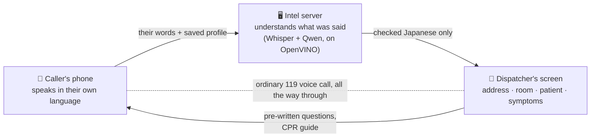

# 救急ブリッジ / Kyūkyū-Bridge

**Helping people who don't speak Japanese get help when they call 119.**

When someone collapses in Japan, the person who calls 119 has to describe the emergency, in
Japanese, to a dispatcher, in the worst minute of their life. Of Japan's ~4.1 million foreign
residents, only about a quarter say they can converse freely in Japanese. Kyūkyū-Bridge lets them speak
**in their own language**, and puts the important facts — **the exact address, the room number,
the patient's medical history, and what is happening right now** — onto the dispatcher's screen,
**in correct, pre-checked Japanese**, while the normal phone call carries on.

> **Status (October 2026):** working prototype of the language understanding (measured, below);
> the phone-to-dispatcher system is designed and partly built. Exactly what exists and what doesn't
> is in [What's built](#whats-built--honestly).

> **Update — 12 October 2026.** Three changes since this page was written; the full rewrite follows
> once the final architecture is settled:
> - **The AI will run on the caller's phone, not on an Intel server.** Audio never leaves the phone;
>   the server only relays messages. Not built yet — a laptop stands in for the phone. The diagram
>   and the "Intel server" steps below describe the earlier design.
> - **Stage B was replaced by a fine-tuned meaning checker** (mDeBERTa, trained on 287
>   human-reviewed sentences), and **Stage A now runs on llama.cpp** (Qwen2.5-3B, 4-bit, 2.1 GB), a
>   runtime phones can use. OpenVINO remains the development backend on Intel machines.
> - **What the app measures now:** on the locked test2 (run once with this setup) precision 0.923,
>   recall 0.878, **F1 0.900**, 0 false cardiac-arrest alarms (the table below, F1 0.861, is the
>   earlier setup). Original 52: F1 0.981. Probe: F1 0.902. The checker's gain over Stage B was
>   consistent across sets but **not statistically significant** (11 vs 6 sentences, p = 0.33).
>   Details: [`EXPERIMENT_LOG.md`](EXPERIMENT_LOG.md).

---

## How it works — in plain words



**Before any emergency**, a household registers once: address (including building name and room
number), who lives there, their medical conditions, and the language they speak.

**In an emergency:**
1. The caller presses one button and **says what's happening, in their own language** — *"my
   father collapsed and he's shaking"*.
2. The app opens the phone's dialer with **119** filled in. The caller presses Call.
3. While it rings, an **Intel server** works out what was said and matches it to a fixed list of
   symptoms that a human has checked in Japanese.
4. The **dispatcher's screen** shows the address down to the room, the patient's age and
   conditions, and the symptoms — all in Japanese, **before the caller has to say a word of it**.
5. The **voice call continues as normal**, so the dispatcher can still hear the room and talk the
   caller through first aid. The dispatcher can also tap pre-written questions (*"Is he
   breathing?"*), which appear on the caller's phone in their language, and start a **CPR guide**
   on the phone.

### Why that matters

| | |
|---|---|
| **Where's the patient?** | A phone's location is accurate to 10–50 m at best (300 m to several km without GPS), and knows nothing about floors or rooms. In a Tokyo apartment block, 50 m can cover dozens of flats. The pre-registered **room number** is the one thing GPS can't give. |
| **What's wrong?** | A panicking person can't produce clear information in any language. The app turns whatever they say into the short, structured facts a dispatcher needs. |
| **Can the dispatcher trust it?** | The AI **never writes the Japanese.** It only picks from a fixed list of sentences a fluent human checked in advance. If something isn't on the list, it isn't sent. |

---

## The problem, with sources

| | | Source |
|---|---|---|
| Ambulance on scene | **9.8 min** on average after the 119 call | FDMA, 令和7年版 救急・救助の現況 (2026) |
| Extra on-scene time for foreign patients | **3–6 min**, because communication takes time | Sapporo City Fire Bureau, via FDMA |
| Foreign residents who converse freely in Japanese | **23.9%** | 出入国在留管理庁 基礎調査 令和3年度, n=40,000 |
| Foreign residents in Japan | **~4.1 million** | [MOJ, 2026](https://www.moj.go.jp/isa/publications/press/13_00062.html?lang=en) |

Japan's Fire and Disaster Management Agency has also said, in its own words, that generic
translation tools don't fit emergency language:

> 既存の多言語自動翻訳システムを導入する消防機関も出てきているが、救急用のフレーズや傷病者との
> やり取りの面で使い勝手の良いものになっていない

That is the gap: not translation quality, but turning panic into **verified, structured facts**.

---

## What's built — honestly

| | Status |
|---|---|
| Understanding the caller: speech → symptoms (Whisper + two-stage Qwen2.5-3B, on OpenVINO) | ✅ **built and measured** |
| The fixed list of 31 symptom sentences in Japanese, each checked by a fluent human | ✅ built |
| Household setup: postal-code address lookup, building and room in Japanese reading | ✅ built |
| An evaluation system: 4 test sets, including one **locked before any tuning** (below) | ✅ built |
| The message layer between phone and console — with a check, in code, that **refuses any Japanese not taken from the verified list** | ✅ built, 19 tests |
| The dispatcher console, pre-written questions, CPR guide | 🔨 designed, being built |
| A phone app (today's prototype runs on a laptop beside the phone) | 🔨 designed |
| Connection to a real fire department | ⬜ not started — see [the pathway](#the-route-to-a-real-fire-department) |

**The app in this repository today runs the original prototype:** a laptop that plays pre-recorded
Japanese for the dispatcher to hear through a phone on speakerphone. [Why that design was
replaced](#how-the-design-changed) is part of the story.

---

## Safety, by design

1. **The AI never writes Japanese.** It returns IDs from a closed list; the Japanese is looked up.
   This is enforced in code: the message builder (`src/messages.py`) rejects any item whose
   Japanese isn't copied verbatim from `data/ontology.json`, and a test proves it.
2. **The three vital signs never come from the AI.** Is the person awake? Breathing? Pale or in a
   cold sweat? These are big yes/no buttons. A small model was measured inverting "still awake"
   into "unconscious" — the worst possible mistake here.
3. **The caller confirms twice:** *did we hear you right?* and *did we understand you right?* They
   can remove or add symptoms before anything is final.
4. **A false cardiac-arrest alarm fails any test run outright**, whatever the other scores say.
5. **Unknown means omitted, never guessed** — patient details, sex, location.

---

## Measured results

### How we test

| Test set | Size | Used for |
|---|---|---|
| Original set | 52 | the published baseline. **Frozen** — never edited |
| Diagnostic probe | 43 | six kinds of difficulty: recognition, staying silent when nothing applies, negation, time, out-of-scope, panicked speech |
| Development set | 41 | choosing settings — never used to report results |
| **test2 — locked** | 34 | written **before** any tuning, and never used to choose anything. SHA-256 recorded at lock: `b421ab3f…fdd33`, so anyone can check it was never edited |

Every sentence in the newer sets had to pass one rule: **would a real caller actually say this?**

### Results — OpenVINO INT8, Stage A + Stage B (the app's setup until 12 October 2026; see the update at the top)

| | Precision | Recall | F1 | False cardiac-arrest alarms |
|---|---|---|---|---|
| **test2 — never seen, never tuned on** | **0.895** | **0.829** | **0.861** | **0** |
| Original 52 | 0.961 | 0.925 | 0.942 | 0 |
| Diagnostic probe | 0.800 | 0.889 | 0.842 | 0 |

*Precision: of the symptoms it reports, how many are right. Recall: of the symptoms that were
there, how many it found.*

**test2 is the honest headline.** It's lower than the original 52 — likely a sign the 52 had
become slightly familiar through months of development. That's exactly why test2 exists.

The original 52 was first published from plain PyTorch (precision 0.98, recall 0.94, F1 0.96).
INT8 quantisation costs about two points of F1; the table above is what a caller actually gets.

### What we found when we looked inside

The classifier has two stages: **Stage A** proposes possible symptoms, **Stage B** removes wrong
ones. Error analysis showed most misses came from Stage B deleting *correct* answers. We then
**proved why**: asked to judge the same symptoms one at a time instead of as a list, Stage B kept
**100%** of correct ones instead of 89% — and **57%** of wrong ones instead of 17%. Stage B compares
candidates **against each other**, not against what the caller said. No prompt wording can fix
that; it's how it decides.

### Ideas that failed — reported, not hidden

| Tried | Result |
|---|---|
| Making Stage B stricter (three ways) | worse every time — one variant dropped F1 from 0.91 to 0.77 |
| A smaller model (Qwen2.5-1.5B) | 2.4× faster, but **doubled** made-up symptoms. Rejected |
| INT4 compression | **slower** than INT8 on this CPU. Rejected |
| A ready-made "meaning checker" (NLI model) instead of Stage B | found every symptom Stage B threw away — but let through **3 false choking alarms**. Failed |
| Stage B plus the checker rescuing what B removed | one case fixed, one broken. A draw. Not adopted |

**Done since:** the checker was taught emergency language with 287 human-reviewed example
sentences (fine-tuning) and tested once on test2. It beat Stage B and replaced it (see the update at
the top). Full record: [`EXPERIMENT_LOG.md`](EXPERIMENT_LOG.md).

---

## Intel technology — what it does here, and why

Two AI models run in the emergency path: **Whisper** (speech → text) and **Qwen2.5-3B**
(text → symptoms). Everything else is deterministic code.

| | Result |
|---|---|
| **OpenVINO vs plain PyTorch** on the target Intel laptop | one classification: **511 s → 73 s** (6.97×). Without OpenVINO, the feature doesn't work on this hardware |
| **Prefix caching** (OpenVINO GenAI) | ~800 of every prompt's ~884 tokens are identical each time. Caching them: **42.11 s → 3.85 s, 10.94× faster, byte-identical output**. Runs only on x64 — on our Apple-Silicon dev machine it refuses to start |
| **INT8 compression** (NNCF) | Qwen to 2.9 GB, Whisper 926 MB → 242 MB |
| **INT4** | tested, **slower** on this CPU (13.25 s vs 9.65 s). Rejected on evidence |
| **The meaning checker** (mDeBERTa, experimental) | converted to OpenVINO INT8 (332 MB), ~0.035 s per check on Apple Silicon |

**Honest notes:**
- OpenVINO isn't a blanket speedup: on Apple Silicon it made Whisper *slower* (17.10 s vs 2.37 s).
- The OpenVINO Whisper is converted but **switched off**: with the anti-hallucination settings the
  app needs, the library versions raise a `TypeError`. We kept the safety settings and left that
  speedup on the table, so the shipped footprint is ~3.9 GB, not ~3.1 GB.
- In the new design the models run on an **Intel server**, not the caller's phone. OpenVINO is an
  Intel runtime and doesn't run on phone chips; a server also gives one reproducible latency figure.

---

## The route to a real fire department

Japan's Fire and Disaster Management Agency publishes **「消防機関への緊急通報に係る標準インターフェイス」**,
a standard way for emergency-reporting services to send data to a fire department's dispatch
system, and a list of conditions such services must meet (第1版, 令和6年3月). Read from the
primary source:

- It's open to services whose users **pre-register** — which this is.
- The dispatcher-side terminal must **work on its own** even without a link to the dispatch
  system — so a first installation can be a screen on the desk.
- It carries text and data. It doesn't carry voice — **the ordinary 119 call stays exactly as it is.**
- The service must meet concrete security conditions: encryption, fixed server addresses, logs kept
  for a year or more, intrusion detection.

The closest existing service is **Smart911** in the USA (3,500+ municipalities): a pre-registered
profile appears on the call-taker's screen when the registered phone calls 911, including the
caller's language — and there it stops. **Kyūkyū-Bridge is the part that comes after: actually
bridging the language, with output a human verified in advance.**

| | Smart911 | AI translation (Prepared, Carbyne) | **Kyūkyū-Bridge** |
|---|---|---|---|
| Pre-registered profile | ✅ | ❌ | ✅ |
| Voice call continues | ✅ | ✅ | ✅ |
| Shows the caller's language | ✅ | ✅ | ✅ |
| Bridges the language | ❌ | ✅ | ✅ |
| Japanese checked by a human in advance, not machine-translated | — | ❌ | ✅ |
| Guides the caller in their own language | ❌ | partly | ✅ (designed) |

Smart911's weak point is a warning for us too: in Arkansas, after three years and $825,000 a year,
under 2% of households had registered. Getting people registered is the hardest part of this kind
of service, and we treat it as such.

---

## How the design changed

The first version, submitted to the Intel AI Global Impact Festival, played Japanese audio for the
dispatcher to hear — which needed two devices. We then tried to make it work on one phone and
found it **can't**:

- **Android:** apps can't put audio into a phone call. The permission is reserved for system apps
  (verified in the Android source code), and emergency calls always use the built-in dialer.
- **iOS:** an API exists, but it can't be tested on 119 calls — test-dialling 119 is treated as
  obstructing emergency services in Japan.
- **Holding the speaker to the phone:** fails silently on some handsets. The caller hears the
  audio; the dispatcher hears nothing.

So the information goes to the dispatcher **as data on a screen** instead of as sound.

**Two things said in the original demo video no longer hold, and we say so here:**

| Said | Now |
|---|---|
| "Offline, on-device, 24/7" | True of the original prototype. The new design needs a network connection — as do NET119 and 救急ボイストラ. |
| "No fire department has to install this today" | **Withdrawn.** It depended on the audio route above, which was never verified. The new design needs a terminal at the fire department. |

---

## Known limitations

- **Stage A doesn't find everything on new sentences:** about 88% of symptoms on test2. *"Tumbled
  down the steps"*, *"going to be sick"*, *"mumbling like he's drunk"* were missed.
- **Out-of-scope emergencies are silent:** fracture, cyanosis, poisoning, allergic reaction, burns,
  childbirth aren't on the list yet. Correctly not guessed — but the dispatcher gets nothing.
- **Self-corrections aren't reliable:** *"my father has a stomach… oh sorry, headache"* returned nothing.
- **Time is lost:** *"the bleeding stopped an hour ago"* becomes "heavy bleeding — has stopped";
  the "hour" isn't carried.
- **27 medical-condition terms** (心臓病, 高血圧…) are not yet human-verified.
- **Real panicked speech is untested** — panic is only simulated so far.
- **The interface is in English;** speech works in several languages through Whisper.
- **No fire department has seen it yet.** That conversation is the most valuable missing piece.

---

## Running the current prototype

Requires **Python 3.12** (or 3.9, as on our dev machine; OpenVINO has no wheels for 3.13+).

```bash
python3.12 -m venv .venv && source .venv/bin/activate
pip install -r requirements.txt
python benchmark/convert_slm.py        # optional but strongly recommended: OpenVINO INT8
.venv/bin/streamlit run app.py
```

The first run opens a setup screen. The postal-code lookup is the only network call, made only when
you press it. Without `models/`, the app falls back to plain PyTorch and says so.

**Reproduce the measurements:** `python benchmark/harness.py` (precision, recall, F1 and
cardiac-arrest alarms, per stage) and `python benchmark/error_analysis.py` (where every error came
from).

## Repository map

```
app.py                       the current prototype UI (Streamlit)
src/slm_classify.py          the two-stage classifier — picks IDs, never writes Japanese
src/stt.py                   Whisper speech-to-text
src/session_store.py         phone ↔ console relay and event log (new design)
src/messages.py              phone → console messages, with the Japanese provenance check
data/ontology.json           the verified Japanese symptom list — the heart of the project
benchmark/                   test sets, harness, error analysis, all experiments
EXPERIMENT_LOG.md            every experiment: what was tried, measured, and decided
POSITIONING.md               the regulatory pathway and how this compares to existing services
OPEN_DECISIONS.md            the full decision log, including rejected ideas
```

---

Built by a high-school student in Tokyo. MIT License — see `LICENSE.md`.
